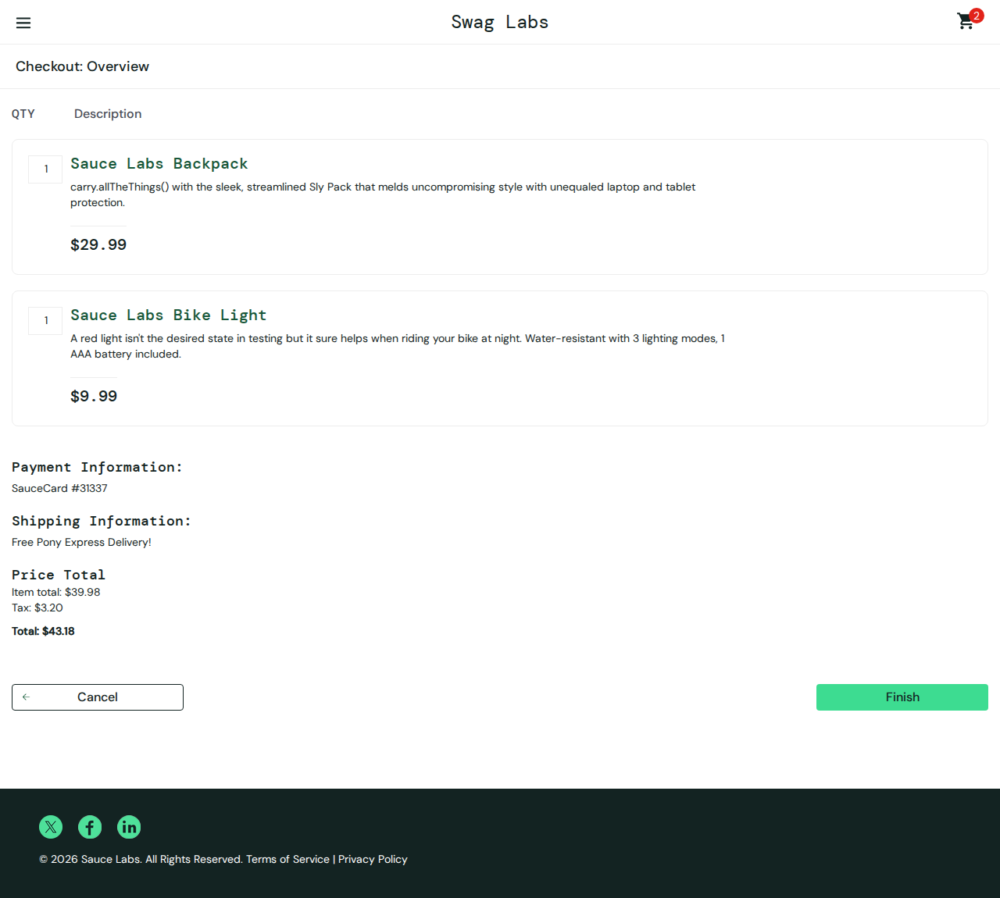

# SauceDemo Playwright tests

Python UI tests for the [public SauceDemo shop](https://www.saucedemo.com/). This repository tests login, product sorting, cart changes and checkout. It uses page objects, pytest fixtures, parametrization and Playwright assertions.

## Local setup on Windows

Python 3.12 and internet access are required. No Docker is used.

```powershell
py -3.12 -m venv .venv
.\.venv\Scripts\python.exe -m pip install -r requirements.txt
.\.venv\Scripts\python.exe -m playwright install chromium firefox
.\.venv\Scripts\python.exe -m pytest --browser chromium --browser firefox --html=reports/all.html --self-contained-html
```

Open `reports/all.html`. Tests use the demo site's published users and password. They do not need personal credentials.

On this Windows machine, Chromium passed all 20 tests. Firefox could not start: Playwright reported `BrowserType.launch: spawn UNKNOWN`; a direct launch returned `WinError 14001` (incorrect side-by-side configuration). Changing the temporary directory did not resolve it. No local Firefox pass is claimed and no system runtime was changed.

## Structure and marker strategy

- `pages/login.py`: login fields and submission.
- `pages/inventory.py`: products, sorting, add/remove and cart navigation.
- `pages/checkout.py`: cart, customer form, order summary and confirmation.
- `tests/`: feature groups, with no selectors in tests.
- `conftest.py`: fresh browser context per test, shared page fixtures, failure PNGs and trace ZIPs. Failure screenshots are also embedded in HTML reports.

| Feature | Cases | Smoke | Regression |
| --- | ---: | ---: | ---: |
| Login | 6 | 1 | 5 |
| Inventory | 8 | 1 | 7 |
| Checkout | 6 | 1 | 5 |
| Total per browser | 20 | 3 | 17 |

Markers are disjoint. Smoke covers valid login, add to cart and full checkout. Regression covers invalid and empty inputs, all four sort orders, removal, badge counts, cancellation and independent subtotal/tax/total expectations. Parametrized cases count as separate tests.

```powershell
.\.venv\Scripts\python.exe -m pytest -m smoke --browser chromium
.\.venv\Scripts\python.exe -m pytest -m regression --browser chromium
```

All UI checks use auto-retrying `expect` assertions. Actions use Playwright's auto waiting. There are no fixed sleeps or automatic retries hiding failed tests.

## CI and reports

GitHub Actions installs Python dependencies and browser system dependencies, then runs smoke followed by regression in each Chromium/Firefox matrix job. If smoke fails, that browser's regression step is skipped. The two browser jobs can run concurrently; tests within each job run sequentially. No pytest-xdist is configured.

Reports, JUnit XML, console logs and any failure screenshots/traces are uploaded even when a test fails. Artifacts are kept for 30 days. Download and unzip the artifact, then open `reports/regression.html`. Open a trace locally with:

```powershell
.\.venv\Scripts\python.exe -m playwright show-trace path\to\trace.zip
```

## Verified results and failure drill

Verified on 25 October 2026 (Europe/Berlin). The [initial green CI run](https://github.com/hamza2829/saucedemo-playwright-python/actions/runs/40141704524) ran all cases without retries:

| Environment | Smoke passed | Regression passed | Total |
| --- | ---: | ---: | ---: |
| GitHub Actions, Chromium | 3 | 17 | 20/20 |
| GitHub Actions, Firefox | 3 | 17 | 20/20 |
| Local Windows, Chromium | 3 | 17 | 20/20 |
| Local Windows, Firefox | Not run | Not run | Browser launch failed |

The Windows run selected 40 cases: 20 Chromium passes and 20 Firefox setup errors. The Firefox cases did not execute. Counts above distinguish local results from CI results.

The failure drill is real and retained in Git history:

1. Commit [`fe9416a`](https://github.com/hamza2829/saucedemo-playwright-python/commit/fe9416a8e1cd3a4bc4ce75b53a7049dfe2f20052) changed only the expected checkout total from `$43.18` to `$44.18`.
2. [Failed CI run 40141740908](https://github.com/hamza2829/saucedemo-playwright-python/actions/runs/40141740908) passed all 3 smoke cases on each browser. Each regression job reported 1 failure and 16 passes. The failing case was `test_order_total` on both browsers.
3. Commit `9ec38e0` restored `$43.18`. The subtotal is `$39.98`, tax is `$3.20`, and the displayed total is `$43.18`. No assertion was removed or weakened.

Exact excerpt from the saved Chromium CI log:

```text
E       AssertionError: Locator expected to have text 'Total: $44.18'
E       Actual value: Total: $43.18
================= 1 failed, 16 passed, 3 deselected in 18.60s ==================
```

The screenshot shows the actual page at failure, not an edited mockup:



Permanent copies downloaded from that failed CI run:

| Browser | Screenshot | Trace | Full pytest log | JUnit |
| --- | --- | --- | --- | --- |
| Chromium | [PNG](docs/evidence/failure-drill/chromium/failure.png) | [ZIP](docs/evidence/failure-drill/chromium/trace.zip) | [Log](docs/evidence/failure-drill/chromium/regression.log) | [XML](docs/evidence/failure-drill/chromium/regression.xml) |
| Firefox | [PNG](docs/evidence/failure-drill/firefox/failure.png) | [ZIP](docs/evidence/failure-drill/firefox/trace.zip) | [Log](docs/evidence/failure-drill/firefox/regression.log) | [XML](docs/evidence/failure-drill/firefox/regression.xml) |

[Evidence manifest](docs/evidence/verification.json) records the run links, parsed XML counts, file SHA-256 hashes and successful trace ZIP integrity checks. These committed copies remain available after the 30-day CI artifact retention period. HTML reports are in the original run's artifacts. Demo credentials and sample checkout details appear in traces; no private customer data is used.

```powershell
.\.venv\Scripts\python.exe -m playwright show-trace docs\evidence\failure-drill\chromium\trace.zip
```

## What to screenshot for the portfolio

1. The final green Actions run with both browser jobs visible.
2. The downloaded HTML report showing 3 smoke passes and 17 regression passes for a browser. Keep the browser name or artifact name visible.
3. The failed drill run with the expected `$44.18` and actual `$43.18` assertion visible.
4. Open the saved trace and capture the checkout overview, action timeline and total. The raw failure screenshots are already committed above.

## Optional AI failure summary

`ai_failure_summary.py` reads a pytest log and calls the OpenAI Responses API only when both `OPENAI_API_KEY` and `OPENAI_MODEL` are set. It is an optional helper, not part of the pass/fail decision and not enabled in CI. It skips with exit code 0 when configuration is absent. No keys belong in this repository.

Actually verified: the no-key invocation printed `SKIPPED` and made no request. Three offline unit checks passed for missing credentials, redacted request/response handling and HTTP-error handling. Those checks mock the API. No real LLM request or AI-generated failure summary has been verified. Run the offline checks with `python -m unittest discover -s checks -v`; they are separate from the 20 UI cases and also run in CI after the UI suite passes.

Review the log before sending it to an API. Basic key and bearer-token redaction is included, but is not comprehensive. The helper sends at most the last 18,000 characters and requests `store: false`.

```powershell
# Set OPENAI_API_KEY securely in your local environment, never in a committed file.
$env:OPENAI_MODEL = "your-available-model-id"
.\.venv\Scripts\python.exe ai_failure_summary.py reports\regression.log
```

## Limits

Demo site only. No real payment, production system, API coverage, accessibility audit or visual regression testing. This suite requires the public site's availability and assumes its published catalog prices. Only Chromium and Firefox are in scope. Screenshots are debugging evidence, not pixel comparison tests. Browser crashes or launch failures can prevent screenshots; traces cover browser actions and DOM snapshots, while assertion details are in the pytest report.

## References

- [Playwright Python assertions](https://playwright.dev/python/docs/test-assertions)
- [Playwright trace viewer](https://playwright.dev/python/docs/trace-viewer)
- [pytest-html reports](https://pytest-html.readthedocs.io/en/stable/user_guide.html)
- [OpenAI text generation](https://developers.openai.com/api/docs/guides/text)
